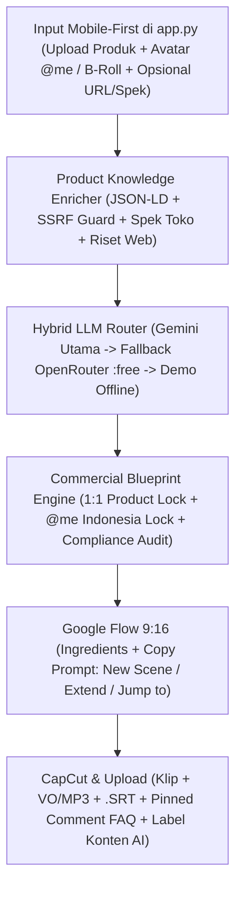

🌐 [English](README.md) | **Bahasa Indonesia** · 📖 **Panduan:** [User Guide (EN)](docs/USER_GUIDE.md) | [Panduan Pengguna (ID)](docs/USER_GUIDE.id.md)

# Affiliate AI Video Director

**Commercial-Grade, Mobile-First & Streamlit Cloud-Ready Creative Director** untuk alur kerja produksi video affiliate **Hybrid (`App → Google Flow → CapCut`)** pada Shopee Video & TikTok Shop.

Aplikasi ini tidak membuang resource untuk render video di backend. Sebagai gantinya, sistem bertugas sebagai **Automated Creative Director, Deep Product Specialist, dan AI Prompt Engineer** yang menghasilkan prompt anti-halu siap tempel ke **Google Flow**, naskah VO Bahasa Indonesia bernilai tambah tinggi, serta paket *finishing* (**MP3 + `.SRT` + Pinned Comment FAQ + Caption**) untuk **CapCut**.

> 📖 **Butuh panduan operasional harian langkah demi langkah dari HP & Cloud?** Baca [Panduan Pengguna Komersial (Bahasa Indonesia)](docs/USER_GUIDE.id.md) atau [Commercial User Guide (English)](docs/USER_GUIDE.md).

---

## Fitur & Keunggulan Utama

1. **Forensic 1:1 Product Geometry Lock (Anti-Halu Bentuk & Kaki Produk)**
   - Vision AI membedah foto produk secara teliti untuk mengisi `exact_product_geometry_lock_en` (struktur kaki/rangka/botol, warna material, sambungan, permukaan, dan posisi logo yang benar-benar terlihat di foto) pada `temperature=0.3`.
   - `src/blueprint_engine.py` menyuntikkan blok `[STRICT PRODUCT LOCK — MATCH UPLOADED PRODUCT INGREDIENT 1:1 ...]` ke setiap adegan dan membersihkan kata kerja deformasi (`folding`, `unfolding`, `folded`, `collapsing`, `assembling`, `morphing`) agar Google Flow tidak mengarang bentuk kaki atau komponen baru.
2. **Native Google Flow `@me` Avatar & Kunci Identitas Asli Indonesia**
   - Secara otomatis menyematkan token berdiri sendiri **`@me`** (tanpa pernah terbungkus kurung `(@me)`) langsung di aksi tiap scene agar Google Flow konsisten memanggil Avatar pribadi pengguna.
   - Mengunci identitas **wajah asli Indonesia** (`Southeast Asian Nusantara facial structure`, kulit natural Indonesia, rambut hitam, *strictly NO Western, NO Caucasian, and NO European facial features*), atau mode **`Tanpa Wajah (Fokus Produk)`** untuk B-roll makro.
3. **Added Value & Deep Product Knowledge (`src/knowledge_enricher.py`)**
   - Menggabungkan **Vision Gambar Produk**, **ekstraksi URL website/review resmi** (HTML + `schema.org/Product` JSON-LD dengan proteksi SSRF, batas 3 *redirect*, filter `Content-Type`, dan batas unduhan 512 KB), **copy-paste spesifikasi toko**, serta **riset snippet web publik**.
   - Menghasilkan bedah spesifikasi & material, tips pakai pro, **Objection Killer** (jawaban keraguan utama pembeli), pembeda kompetitor, serta **Pinned Comment FAQ** siap 1-klik salin.
4. **Hybrid AI Routing (`Gemini Utama → Fallback OpenRouter Gratis`)**
   - Prioritas utama ke **Google Gemini API** (`gemini-2.5-flash` → `gemini-2.5-flash-lite` → `gemini-2.5-pro`).
   - Otomatis beralih cepat saat kuota/RPM penuh (`429`/`404`) ke model `:free` **OpenRouter** (`google/gemma-3-27b-it:free` → `qwen/qwen2.5-vl-72b-instruct:free` → `qwen/qwen2.5-vl-32b-instruct:free` → `openrouter/free`), ditambah **Mode Demo Offline** tanpa API key.
5. **Pacing Komersial, Audit Kepatuhan & Anti-Spam Lintas Sesi**
   - Tersedia format `15 detik (3 scene)`, `25-30 detik (5 scene)`, dan `40-45 detik (7 scene deep)` dengan panjang `vo_script_id` ketat **12–16 kata per scene**.
   - **Audit & Sanitizer Kepatuhan (`src/compliance.py`)** mendeteksi klaim medis absolut, harga palsu, atau transaksi luar aplikasi dengan perbaikan 1-klik, sekaligus menormalkan CTA Shopee (`Keranjang Oranye`), TikTok (`Keranjang Kuning`), atau ganda (`cek keranjang di bawah`).
   - Riwayat hook persisten per produk (`projects/hook_history.json`) plus tombol **Regenerate hook** dan **Variasi baru (anti-spam)**.
6. **Cropper Foto Aman, Finishing CapCut & Keamanan Cloud**
   - `src/image_prep.py` mempertahankan foto produk `1:1`, `3:4`, dan `9:16` (`H/W < 1.92`) utuh 100% agar bagian kaki bawah tidak terpotong; hanya memangkas screenshot HP ekstra-panjang (`H/W >= 1.92`) secara konservatif.
   - Ekspor otomatis `blueprint.json`, `blueprint.md`, `capcut_subtitles.srt`, dan tombol opsional **Audio MP3 + SRT sinkron per kata** (`edge-tts`).
   - Mendukung `.env` lokal dan `st.secrets` Cloud, kunci akses opsional **`APP_PIN`** (*constant-time* `hmac.compare_digest`), batas unggahan (`4` gambar, maks `10 MB`/file), serta penyamaran kunci di log error (`redact_secrets`).

---

## Arsitektur Alur Kerja



---

## Struktur Repositori

| Path | Peran |
| :--- | :--- |
| `app.py` | Antarmuka utama Streamlit (Mobile-First, gerbang `APP_PIN` opsional, validasi upload) |
| `config.yaml` | Daftar endpoint & prioritas model Gemini, OpenRouter (`free_router`, `budget_pro`), TTS, dan path |
| `requirements.txt` | Dependensi runtime ringan untuk Streamlit Community Cloud |
| `pyproject.toml` | Konfigurasi `pytest` dan optional `[project.optional-dependencies].dev` |
| `.python-version` | Target Python `3.12` untuk Streamlit Community Cloud |
| `.env.example` | Template variabel environment lokal (`GEMINI_API_KEY`, `GEMINI_MODEL`, `OPENROUTER_API_KEY`, `APP_PIN`) |
| `.streamlit/config.toml` | Tema light/dark bawaan (aksen Shopee Coral, tanpa CSS hack) |
| `.streamlit/secrets.toml.example` | Template TOML siap tempel ke **Streamlit Cloud → Settings → Secrets** |
| `scripts/copy_secrets_for_cloud.py` | Utilitas CLI Mac untuk menyalin `.env` lokal ke clipboard sebagai TOML Cloud Secrets |
| `docs/USER_GUIDE.md` | Commercial Operations Playbook (**English**) |
| `docs/USER_GUIDE.id.md` | Panduan Operasional Komersial (**Bahasa Indonesia**) |
| `src/schemas.py` | Skema Pydantic v2 (`TalentSavedProfile`, `ProductKnowledgeBrief`, `FlowSetup`, `FlowScene`, `BlueprintResponse`) |
| `src/prompts.py` | System prompt sutradara komersial, pemecah tag `@me`, & *Offline Demo builder* |
| `src/blueprint_engine.py` | Penegak 1:1 *Product Geometry Lock*, sanitasi anti-lipat/rusak, pengikat `@me`, dan CTA |
| `src/knowledge_enricher.py` | Ekstraksi URL & JSON-LD dengan proteksi SSRF, batas redirect & 512 KB, plus riset web |
| `src/llm_client.py` | Klien `GeminiClient`, `OpenRouterClient`, dan `HybridLLMRouter` dengan JSON healing |
| `src/service.py` | Orkestrasi pembuatan blueprint, *regenerate hook*, dan penyimpanan artefak |
| `src/compliance.py` | Auditor risiko klaim platform, perbaikan 1-klik, dan normalizer hashtag |
| `src/image_prep.py` | Cropper screenshot aman menghasilkan `ingredient_produk_bersih.jpg` |
| `src/srt_export.py` | Pembuat file subtitle `.SRT` siap impor ke CapCut |
| `src/voiceover.py` | Pembuat audio VO MP3 + subtitle `.SRT` sinkron per kata via `edge-tts` |
| `src/exporter.py` | Eksportir `blueprint.json`, `blueprint.md`, dan `capcut_subtitles.srt` |
| `src/history_store.py` | Penyimpan riwayat hook lintas sesi (`hook_history.json`) dan pemuat proyek tersimpan |
| `src/talent_store.py` | Penyimpan preset karakter (`@me` Pria/Wanita/Hijab Indonesia & Tanpa Wajah) |
| `src/config.py` | Loader `.env` + `st.secrets` (aman huruf besar/kecil & TOML bersarang) serta `redact_secrets` |
| `tests/test_*.py` | 6 suite pengujian otomatis (`pytest`) untuk UI `AppTest`, kunci geometri & `@me`, SSRF, LLM, dan compliance |

---

## Cara Memulai Cepat

### 1. Menjalankan di Lokal

```bash
cd path/to/video_affliate_generator
python3 -m venv .venv
source .venv/bin/activate
pip install -r requirements.txt

cp .env.example .env
# Isi GEMINI_API_KEY dan/atau OPENROUTER_API_KEY di file .env
streamlit run app.py
```

### 2. Deploy Gratis ke Streamlit Community Cloud (Akses 100% dari HP)

1. Push repositori ini ke **GitHub Private Repo** (`.gitignore` otomatis memblokir `.env`, `.streamlit/secrets.toml`, `profile/`, dan `projects/`).
2. Buka [share.streamlit.io](https://share.streamlit.io) → **Create app** → pilih repo Anda, branch `main`, dan main file `app.py`.
3. Buka **Advanced settings...**, pilih Python `3.12`, lalu isi kotak **Secrets** (di Mac, jalankan `.venv/bin/python scripts/copy_secrets_for_cloud.py` untuk menyalin `.env` ke clipboard dalam format TOML):

```toml
GEMINI_API_KEY = "AIzaSy..."
GEMINI_MODEL = "gemini-2.5-flash"
OPENROUTER_API_KEY = "sk-or-v1-..."
APP_PIN = "123456"
```

---

## Pengujian Otomatis (`pytest`)

Pasang *dev dependencies* lalu jalankan seluruh tes (`24 passed`):

```bash
pip install -e ".[dev]"
pytest -v tests/
```
