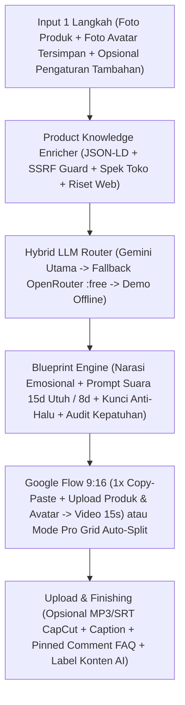

🌐 [English](README.md) | **Bahasa Indonesia** · 📖 **Panduan:** [User Guide (EN)](docs/USER_GUIDE.md) | [Panduan Pengguna (ID)](docs/USER_GUIDE.id.md)

# Affiliate AI Video Director

**Studio `1× Copy-Paste` Berkelas Komersial (Laptop-First & Cloud-Mobile)** untuk alur kerja produksi video affiliate **Hybrid (`App → Google Flow → CapCut`)** pada Shopee Video & TikTok Shop Indonesia.

Aplikasi ini tidak membuang *resource* untuk render video di backend. Sebagai gantinya, sistem bertugas sebagai **Senior AI Video Director, UGC Creator & Scriptwriter Specialist** — menghasilkan **1 kotak prompt siap tempel (`1× Copy-Paste`)** dengan wajah **Avatar `@me`**, kunci produk **`@ProductAuthority`**, dan **suara Bahasa Indonesia natural yang menjelaskan produk**, lengkap dengan alur narasi emosional serta **Mode Pro opsional** (`Storyboard Grid`, `Auto-Splitter ZIP`, `Start-to-End Frame`, MP3 & `.SRT` CapCut).

> 📖 **Butuh panduan operasional harian langkah demi langkah untuk Laptop & HP?** Baca [Panduan Pengguna Komersial (Bahasa Indonesia)](docs/USER_GUIDE.id.md) atau [Commercial User Guide (English)](docs/USER_GUIDE.md).

---

## Fitur & Keunggulan Utama

1. **Studio `1× Copy-Paste` Anti-Bingung (Default `15 Detik Utuh` + Avatar & Suara Indonesia)**
   - Upload foto produk + upload **Foto Avatar Anda 1 kali saja** (`profile/avatar_photo.jpg` otomatis tersimpan persisten).
   - Tersedia pilihan cepat **`15 detik utuh` (*default*)** dan **`8 detik`**: mode `15s` menggabungkan naskah adegan 1–3 (*Hook → Solusi Produk → Before vs After + CTA*) dengan instruksi `"no looping"` agar Google Flow menghasilkan video 15 detik penuh bersuara Bahasa Indonesia tanpa mengulang.
   - Dilengkapi tombol langsung **`Buka Google Flow`**, tampilan teks *Script suara (VO)* yang selalu terlihat, serta tombol 1-klik audio **`vo_capcut.mp3` + `.srt`** (`edge-tts`).
2. **Storyboard Narasi Emosional Bernilai Tambah (`ugc-director-prompt-studio`)**
   - Mengungguli affiliator biasa (yang cuma membaca judul produk) dengan alur konversi terstruktur di `COMMERCIAL_DIRECTOR_SYSTEM_PROMPT` & `.agents/skills/ugc-director-prompt-studio/`:
     **Sentuh Emosi & Painful Nyata → Apa yang Di-Solve (Solusi & Bukti Bahan) → Kontras Before vs After yang Aman → Objection Killer → CTA Platform**.
3. **Kunci Anti-Halu Minimalis (`<= 35` Kata Inti Visual + `@ProductAuthority` + `@me` Mandiri)**
   - `src/blueprint_engine.py` membersihkan kurung siku `[...]`, tanda kutip ganda `"`, ciri wajah Barat, kata kerja pemicu halu (`walks toward`, `picks up`, `opens`), kata kerja deformasi (`folding`, `unfolding`, `collapsing`), dan pengulangan deskripsi warna/logo fisik, sambil memastikan tag `@ProductAuthority`, `@me Indonesian ... presenter`, dan penutup `No text overlays, no additional logos, no readable screens.`
4. **Mode Pro Opsional (`Visual Storyboard Grid`, `Auto-Splitter ZIP`, `Start-to-End Frame`, `Cropper`)**
   - Tersimpan rapi di lipatan tertutup **Mode pro** agar pemula tetap fokus, sementara pengguna lanjutan bisa menyalin prompt **Contact Sheet Grid (`2x2` / `3x2` / `3x3`)**, memotong gambar Grid secara otomatis menjadi `keyframe_1..N.jpg` + ZIP (`split_storyboard_grid()` & `build_frames_zip()`), atau mengatur ulang *slider crop* screenshot HP.
5. **Product Knowledge Enricher & Hybrid AI Routing (`Gemini Utama → Fallback OpenRouter Gratis`)**
   - `src/knowledge_enricher.py` menggabungkan **Vision Foto Produk**, ekstraksi **URL website resmi / JSON-LD `schema.org/Product`** (terproteksi SSRF, batas 3 *redirect*, batas 512 KB), **spesifikasi toko**, dan **riset web** menjadi poin teknis, tips pakai pro, dan **Pinned Comment FAQ**.
   - Memprioritaskan **Google Gemini API** (`gemini-2.5-flash` → `gemini-2.5-flash-lite` → `gemini-2.5-pro`) lalu otomatis beralih ke model `:free` **OpenRouter** saat kuota limit, plus **Mode Demo Offline** tanpa API key.
6. **Tampilan Ganda Laptop (`2-Kolom`) / HP (`1-Kolom`), Audit Kepatuhan & Keamanan Cloud**
   - Pengaturan di sidebar dapat berpindah antara **Laptop (`2-Kolom` default)** dan **Mobile / HP (`1-Kolom`)**; **Audit Kepatuhan (`src/compliance.py`)** mengecek klaim medis/harga palsu/tautan luar aplikasi dan menyesuaikan CTA (`Keranjang Oranye` / `Keranjang Kuning` / `cek keranjang di bawah`); dilengkapi gerbang **`APP_PIN`** (*constant-time* `hmac.compare_digest`), batas unggahan (`4` gambar / `10 MB`), dan `redact_secrets`.

---

## Arsitektur Alur Kerja



---

## Struktur Repositori

| Path | Peran |
| :--- | :--- |
| `app.py` | Antarmuka Studio `1× Copy-Paste` (Laptop 2-Kolom & Mobile 1-Kolom), pemilih klip `15s`/`8s`, `APP_PIN`, & lipatan Mode Pro |
| `config.yaml` | Daftar endpoint & prioritas model Gemini, OpenRouter (`free_router`, `budget_pro`), suara TTS, dan path |
| `requirements.txt` | Dependensi runtime ringan untuk Streamlit Community Cloud |
| `pyproject.toml` | Konfigurasi `pytest` dan optional `[project.optional-dependencies].dev` |
| `.python-version` | Target Python `3.12` untuk Streamlit Community Cloud |
| `.env.example` | Template variabel environment lokal (`GEMINI_API_KEY`, `GEMINI_MODEL`, `OPENROUTER_API_KEY`, `APP_PIN`) |
| `.streamlit/config.toml` | Tema light/dark bawaan (aksen Shopee Coral, tanpa CSS hack) |
| `.streamlit/secrets.toml.example` | Template TOML siap tempel ke **Streamlit Cloud → Settings → Secrets** |
| `scripts/copy_secrets_for_cloud.py` | Utilitas CLI Mac untuk menyalin `.env` lokal ke clipboard sebagai TOML Cloud Secrets |
| `docs/USER_GUIDE.md` | Commercial Operations Playbook (**English**) |
| `docs/USER_GUIDE.id.md` | Panduan Operasional Komersial (**Bahasa Indonesia**) |
| `docs/GOOGLE_FLOW_PROMPT_PLAYBOOK.md` | Playbook Terpadu `15s` Suara & Avatar + Storyboard Narasi/Visual + Formula Anti-Halu |
| `.agents/skills/affiliate-ai-video-director/SKILL.md` | Skill agen **Affiliate AI Video Director** (Veo 3.1 anti-halu & 3 Peran Ingredients) |
| `.agents/skills/ugc-director-prompt-studio/SKILL.md` | Skill agen **Senior AI Video Director, UGC Creator & Scriptwriter Specialist** (+ `references/` kerangka narasi, templat, QC) |
| `src/schemas.py` | Skema Pydantic v2 (`WorkflowMode`, `TalentSavedProfile`, `ProductKnowledgeBrief`, `FlowSetup`, `FlowScene`, `BlueprintResponse`) |
| `src/prompts.py` | System prompt terpadu (Narasi Emosional + Anti-Halu), pemecah tag `@me`, & *Offline Demo builder* |
| `src/blueprint_engine.py` | Normalisasi anti-halu, `compose_talking_voice_flow_prompt()`, `compose_full_15s_flow_prompt()`, & normalizer grid Storyboard |
| `src/knowledge_enricher.py` | Ekstraksi URL & JSON-LD dengan proteksi SSRF, batas redirect & 512 KB, plus riset web |
| `src/llm_client.py` | Klien `GeminiClient`, `OpenRouterClient`, dan `HybridLLMRouter` dengan JSON healing |
| `src/service.py` | Orkestrasi pembuatan blueprint, *regenerate hook*, dan penyimpanan artefak |
| `src/compliance.py` | Auditor risiko klaim platform, perbaikan 1-klik, dan normalizer CTA/hashtag |
| `src/image_prep.py` | Cropper screenshot aman, `build_product_turnaround_sheet()` multi-sudut, + `split_storyboard_grid()` & `build_frames_zip()` |
| `src/srt_export.py` | Pembuat file subtitle `.SRT` siap impor ke CapCut |
| `src/voiceover.py` | Pembuat audio VO MP3 + subtitle `.SRT` sinkron per kata via `edge-tts` |
| `src/exporter.py` | Eksportir `blueprint.json`, `blueprint.md`, dan `capcut_subtitles.srt` |
| `src/history_store.py` | Penyimpan riwayat hook lintas sesi (`hook_history.json`) dan pemuat proyek tersimpan |
| `src/talent_store.py` | Penyimpan preset karakter (`talent_presets.json`) & foto Avatar persisten (`avatar_photo.jpg`) |
| `src/config.py` | Loader `.env` + `st.secrets` (aman huruf besar/kecil & TOML bersarang) serta `redact_secrets` |
| `tests/test_*.py` | 6 suite pengujian otomatis (`pytest`: `28 passed`) untuk UI `AppTest`, prompt 15s/8s + suara, avatar persisten, turnaround sheet, grid splitter, SSRF, LLM, & compliance |

---

## Cara Memulai Cepat

### 1. Menjalankan di Lokal

```bash
cd path/to/video_affliate_generator
python3 -m venv .venv
source .venv/bin/activate
pip install -r requirements.txt

cp .env.example .env
# Isi GEMINI_API_KEY dan/atau OPENROUTER_API_KEY di file .env
streamlit run app.py
```

### 2. Deploy Gratis ke Streamlit Community Cloud (Akses dari HP)

1. Push repositori ini ke **GitHub Private Repo** (`.gitignore` otomatis memblokir `.env`, `.streamlit/secrets.toml`, `profile/`, dan `projects/`).
2. Buka [share.streamlit.io](https://share.streamlit.io) → **Create app** → pilih repo Anda, branch `main`, dan main file `app.py`.
3. Buka **Advanced settings...**, pilih Python `3.12`, lalu isi kotak **Secrets** (di Mac, jalankan `.venv/bin/python scripts/copy_secrets_for_cloud.py` untuk menyalin `.env` ke clipboard dalam format TOML):

```toml
GEMINI_API_KEY = "AIzaSy..."
GEMINI_MODEL = "gemini-2.5-flash"
OPENROUTER_API_KEY = "sk-or-v1-..."
APP_PIN = "123456"
```

---

## Pengujian Otomatis (`pytest`)

Pasang *dev dependencies* lalu jalankan seluruh tes (`28 passed`):

```bash
pip install -e ".[dev]"
pytest -v tests/
```
