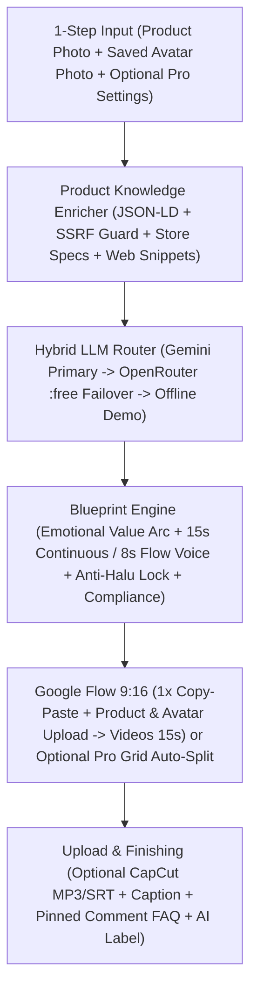

🌐 **English** | [Bahasa Indonesia](README.id.md) · 📖 **Playbook:** [User Guide (EN)](docs/USER_GUIDE.md) | [Panduan Pengguna (ID)](docs/USER_GUIDE.id.md)

# Affiliate AI Video Director

**Commercial-Grade, Dual Laptop-First & Cloud-Mobile `1× Copy-Paste` Studio** for the hybrid **`App → Google Flow → CapCut`** affiliate video workflow (Shopee Video & TikTok Shop Indonesia).

Instead of burning local server compute on rendering, this application acts as your **Senior AI Video Director, UGC Creator & Scriptwriter Specialist**—delivering a foolproof 3-step `1× Copy-Paste` prompt (featuring your **`@me` Avatar**, **`@ProductAuthority`** lock, and **natural Indonesian spoken voiceover explaining the product**), an emotional added-value narrative storyboard, plus an optional **Pro Mode** (`Nano Banana Contact Sheet Grid`, `Auto-Splitter ZIP`, `Start-to-End Frame`, and `edge-tts` MP3 + `.SRT`).

> 📖 **Need step-by-step daily SOPs for Laptop & Mobile?** Read the [Commercial User Guide (English)](docs/USER_GUIDE.md) or [Panduan Pengguna Komersial (Bahasa Indonesia)](docs/USER_GUIDE.id.md).

---

## Core Capabilities

1. **Zero-Confusion `1× Copy-Paste` Studio (Default `15s` Talking Avatar + Indonesian Voice)**
   - Upload your uncropped product photo + upload your personal **Avatar photo once** (`profile/avatar_photo.jpg` is persisted automatically across sessions).
   - Pick **`15 detik utuh` (default)** or **`8 detik`** right above the main copy box: the `15s` mode combines Scenes 1–3 (*Hook → Solution → Before vs After + CTA*) into one continuous `"no looping"` Google Flow prompt with Indonesian voice & lip-sync so a 15-second generation never repeats mid-clip.
   - Includes a direct **`Buka Google Flow`** button alongside visible VO script and optional 1-click **`vo_capcut.mp3` + `.srt`** synthesis (`edge-tts`).
2. **Emotional Added-Value Narrative Storyboard (`ugc-director-prompt-studio`)**
   - Beats generic affiliates with a structured conversion arc baked into `COMMERCIAL_DIRECTOR_SYSTEM_PROMPT` and `.agents/skills/ugc-director-prompt-studio/`:
     **Touch Emotion & Real Pain (`Painful Nyata`) → What It Solves (`Apa yang Di-Solve`) → Safe `Before vs After` Contrast → `Objection Killer` → Platform CTA**.
3. **Minimalist Anti-Halu Lock (`<= 35`-Word Core Visual + `@ProductAuthority` + Standalone `@me`)**
   - `src/blueprint_engine.py` guards against product mutations by stripping meta-brackets `[...]`, double quotes `"`, Western appearance descriptors, narrative trigger verbs (`walks toward`, `picks up`, `opens`), mechanical deformation verbs (`folding`, `unfolding`, `collapsing`), and color/part re-descriptions, while enforcing space-bounded `@ProductAuthority` & `@me Indonesian ... presenter` tags plus `No text overlays, no additional logos, no readable screens.`
4. **Optional Pro Mode (`Visual Storyboard Grid`, `Auto-Splitter ZIP`, `Start-to-End Frame`, `Cropper`)**
   - Cleanly collapsed inside **Mode pro** so beginners never feel overwhelmed: generates `2x2` / `3x2` / `3x3` Nano Banana Contact Sheet Grid prompts, slices uploaded grids into numbered `keyframe_1..N.jpg` files (`split_storyboard_grid()` + `build_frames_zip()`), preserves `1:1`, `3:4`, and `9:16` product photos intact (`H/W < 1.92`), and offers manual top/bottom crop sliders for tall phone screenshots.
5. **Deep Product Knowledge Enricher & Hybrid AI Routing (`Gemini → OpenRouter :free → Offline Demo`)**
   - `src/knowledge_enricher.py` merges Vision AI analysis, official brand URL / `schema.org/Product` JSON-LD extraction (SSRF-hardened, max 3 redirects, 512 KB cap), pasted store specifications, and web snippets into concrete specs, usage tips, and a 1-click **Pinned Comment FAQ**.
   - Routes first to **Google Gemini API** (`gemini-2.5-flash` → `gemini-2.5-flash-lite` → `gemini-2.5-pro`) with automatic failover (`429`/`404`) to free **OpenRouter** vision/text models, plus **Offline Demo Mode**.
6. **Dual Laptop (`2-Col`) / Mobile (`1-Col`) Layout, Compliance Gate & Cloud Security**
   - Sidebar settings toggle between **Laptop (2-Kolom default)** and **Mobile / HP (1-Kolom)**; automated **Compliance Auditor (`src/compliance.py`)** catches risky medical/pricing/off-platform claims and normalizes Shopee (`Keranjang Oranye`), TikTok (`Keranjang Kuning`), or Dual CTA wording; optional constant-time **`APP_PIN`** gate (`hmac.compare_digest`), upload caps (`4` images / `10 MB`), and secret masking (`redact_secrets`).

---

## Architecture Workflow



---

## Repository Structure

| Path | Role |
| :--- | :--- |
| `app.py` | Dual Laptop-First & Cloud-Mobile `1× Copy-Paste` Streamlit studio UI, `15s`/`8s` clip selector, `APP_PIN` lock, & Pro expanders |
| `config.yaml` | Model priority lists for Gemini, OpenRouter (`free_router`, `budget_pro`), TTS voices, and paths |
| `requirements.txt` | Lean runtime dependencies for Streamlit Community Cloud |
| `pyproject.toml` | `pytest` configuration and optional `[project.optional-dependencies].dev` |
| `.python-version` | Pinned Python `3.12` runtime for Streamlit Community Cloud |
| `.env.example` | Local environment template (`GEMINI_API_KEY`, `GEMINI_MODEL`, `OPENROUTER_API_KEY`, `APP_PIN`) |
| `.streamlit/config.toml` | Native light/dark theme configuration (Shopee Coral accent, zero CSS hacks) |
| `.streamlit/secrets.toml.example` | Copy-paste TOML template for **Streamlit Cloud → Settings → Secrets** |
| `scripts/copy_secrets_for_cloud.py` | macOS helper CLI to format `.env` as valid Streamlit Cloud TOML and copy to clipboard |
| `docs/USER_GUIDE.md` | Commercial Operations Playbook (**English**) |
| `docs/USER_GUIDE.id.md` | Panduan Operasional Komersial (**Bahasa Indonesia**) |
| `docs/GOOGLE_FLOW_PROMPT_PLAYBOOK.md` | Unified Playbook for `15s` Talking Avatar + Narrative & Visual Storyboard + Anti-Halu Rules |
| `.agents/skills/affiliate-ai-video-director/SKILL.md` | Technical Veo 3.1 Anti-Halu, 3-Role Ingredients, & Storyboard-First agent skill |
| `.agents/skills/ugc-director-prompt-studio/SKILL.md` | Senior AI Video Director, UGC Creator & Scriptwriter Specialist skill (+ `references/` frameworks, templates, QC) |
| `src/schemas.py` | Pydantic v2 models (`WorkflowMode`, `TalentSavedProfile`, `ProductKnowledgeBrief`, `FlowSetup`, `FlowScene`, `BlueprintResponse`) |
| `src/prompts.py` | System prompt combining Emotional Value-Add Arc & Anti-Halu rules, `@me` splitter, & Offline Demo builder |
| `src/blueprint_engine.py` | Anti-halu normalizer (`<= 35`-word core visual), `compose_talking_voice_flow_prompt()`, `compose_full_15s_flow_prompt()`, & Storyboard grid normalizers |
| `src/knowledge_enricher.py` | SSRF-hardened URL & JSON-LD extractor (`512 KB` / 3-redirect cap), store spec combiner, & web snippets |
| `src/llm_client.py` | `GeminiClient`, `OpenRouterClient`, and `HybridLLMRouter` with JSON extraction & failover |
| `src/service.py` | End-to-end blueprint generation, Scene 1 hook regeneration, and project persistence |
| `src/compliance.py` | Platform claim risk auditor, 1-click safe sanitizer, CTA & hashtag normalizers |
| `src/image_prep.py` | Safe screenshot cropper, multi-angle `build_product_turnaround_sheet()`, + Nano Banana `split_storyboard_grid()` & `build_frames_zip()` |
| `src/srt_export.py` | Free timing-calibrated `.SRT` subtitle exporter for CapCut |
| `src/voiceover.py` | Indonesian TTS MP3 + word-boundary `.SRT` generator using `edge-tts` |
| `src/exporter.py` | Markdown, JSON, and `.SRT` artifact writer |
| `src/history_store.py` | Normalized cross-session hook history (`hook_history.json`) and saved project loader |
| `src/talent_store.py` | Preset manager (`talent_presets.json`) & persistent Avatar photo storage (`avatar_photo.jpg`) |
| `src/config.py` | Unified `.env` + `st.secrets` loader and `redact_secrets` utility |
| `tests/test_*.py` | 6 automated test suites (`pytest`: `28 passed`) covering UI `AppTest`, 15s/8s voice prompts, Avatar persistence, turnaround sheet, grid splitters, SSRF, LLM, & compliance |

---

## Quick Start

### 1. Local Setup (macOS / Linux / Windows)

```bash
cd path/to/video_affliate_generator
python3 -m venv .venv
source .venv/bin/activate
pip install -r requirements.txt

cp .env.example .env
# Add GEMINI_API_KEY and/or OPENROUTER_API_KEY inside .env
streamlit run app.py
```

### 2. Free Cloud Deployment (Streamlit Community Cloud — Mobile Access)

1. Push this repository to a **Private GitHub Repo** (`.gitignore` automatically excludes `.env`, `.streamlit/secrets.toml`, `profile/`, and `projects/`).
2. Open [share.streamlit.io](https://share.streamlit.io) → **Create app** → select your repo, branch `main`, and main file `app.py`.
3. Under **Advanced settings...**, choose Python `3.12` and paste your secrets into **Secrets** (on macOS, run `.venv/bin/python scripts/copy_secrets_for_cloud.py` to copy `.env` in TOML format):

```toml
GEMINI_API_KEY = "AIzaSy..."
GEMINI_MODEL = "gemini-2.5-flash"
OPENROUTER_API_KEY = "sk-or-v1-..."
APP_PIN = "123456"
```

---

## Automated Testing (`pytest`)

Install dev dependencies and run the full suite (`28 passed`):

```bash
pip install -e ".[dev]"
pytest -v tests/
```
