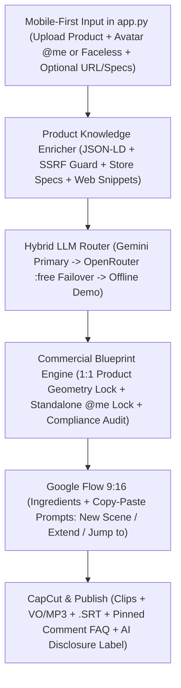

🌐 **English** | [Bahasa Indonesia](README.id.md) · 📖 **Playbook:** [User Guide (EN)](docs/USER_GUIDE.md) | [Panduan Pengguna (ID)](docs/USER_GUIDE.id.md)

# Affiliate AI Video Director

**Commercial-Grade, Mobile-First & Streamlit Cloud-Ready Creative Director** for the hybrid **`App → Google Flow → CapCut`** affiliate video production workflow (Shopee Video & TikTok Shop).

Rather than wasting server compute on backend video rendering, this application serves as an **Automated Creative Director, Deep Product Specialist, and AI Prompt Engineer**—generating anti-hallucination scene prompts for **Google Flow**, high-value Indonesian voiceover scripts, and a complete finishing kit (**MP3 + `.SRT` + Pinned Comment FAQ + Platform Captions**) for **CapCut**.

> 📖 **Looking for step-by-step daily mobile & Cloud SOPs?** Read the [Commercial User Guide (English)](docs/USER_GUIDE.md) or [Panduan Pengguna Komersial (Bahasa Indonesia)](docs/USER_GUIDE.id.md).

---

## Core Capabilities

1. **Forensic 1:1 Product Geometry Lock (Zero Product Hallucination)**
   - Vision AI inspects the uploaded product photo to populate `exact_product_geometry_lock_en` (exact leg/frame/bottle structure, material colors, joints, surfaces, and logo placement) at `temperature=0.3`.
   - `src/blueprint_engine.py` injects a `[STRICT PRODUCT LOCK — MATCH UPLOADED PRODUCT INGREDIENT 1:1 ...]` guard into every scene and deterministically sanitizes mechanical deformation verbs (`folding`, `unfolding`, `folded`, `collapsing`, `assembling`, `morphing`) so Google Flow never fabricates altered legs, hinges, or missing parts.
2. **Native Google Flow `@me` Avatar & Authentic Indonesian Identity Lock**
   - Automatically embeds standalone **`@me`** (never wrapped in parentheses like `(@me)`) directly into each scene action so Google Flow binds the user's personal avatar consistently.
   - Enforces authentic Indonesian facial identity (`Southeast Asian Nusantara facial structure`, natural warm skin tone, dark black hair, *strictly NO Western, NO Caucasian, and NO European facial features*), alongside a **`Tanpa Wajah (Fokus Produk)`** faceless macro B-roll mode.
3. **Added Value & Deep Product Knowledge (`src/knowledge_enricher.py`)**
   - Combines **Product Image Vision**, **official brand/review URL extraction** (HTML + `schema.org/Product` JSON-LD protected by SSRF validation, max 3-hop redirect checks, `Content-Type` filtering, and a 512 KB response-size cap), **pasted store specifications**, and **public web search snippets**.
   - Produces concrete technical specs/materials, pro usage tips, buyer **Objection Killer** answers, competitor differentiators, and a 1-click copy **Pinned Comment FAQ**.
4. **Hybrid AI Routing (`Gemini Primary → OpenRouter Free Failover`)**
   - Routes first to **Google Gemini API** (`gemini-2.5-flash` → `gemini-2.5-flash-lite` → `gemini-2.5-pro`).
   - Seamlessly fails over on quota/RPM limits (`429`/`404`) to free **OpenRouter** vision/text models (`google/gemma-3-27b-it:free` → `qwen/qwen2.5-vl-72b-instruct:free` → `qwen/qwen2.5-vl-32b-instruct:free` → `openrouter/free`), plus a built-in **Offline Demo Mode** requiring zero API keys.
5. **Commercial Pacing, Compliance & Cross-Session Anti-Spam**
   - Supports `15 detik (3 scene)`, `25-30 detik (5 scene)`, and `40-45 detik (7 scene deep)` formats locked to **12–16 Indonesian words per 5-second scene**.
   - Automated **Compliance Auditor & 1-Click Sanitizer (`src/compliance.py`)** catches absolute medical claims, fake superlative pricing, or off-platform transaction links, while normalizing Shopee (`Keranjang Oranye`), TikTok (`Keranjang Kuning`), or Dual CTA phrasing.
   - Persistent per-product hook history (`projects/hook_history.json`) plus 1-click **Regenerate hook** (Scene 1) and **Variasi baru (anti-spam)** generation.
6. **Safe Ingredient Cropper, CapCut Finishing & Cloud Security**
   - `src/image_prep.py` preserves `1:1`, `3:4`, and standard `9:16` product photos 100% uncropped (`H/W < 1.92`) so lower chair legs or bottle bases are never cut off; trims ultra-tall phone screenshots (`H/W >= 1.92`) conservatively with manual re-crop sliders.
   - Exports `blueprint.json`, `blueprint.md`, `capcut_subtitles.srt`, and optional word-synced Indonesian TTS **`vo_capcut.mp3` + `vo_capcut.srt`** via `edge-tts`.
   - Reads `.env` locally and `st.secrets` on Streamlit Cloud (case-insensitive & nested TOML safe), enforces optional constant-time **`APP_PIN`** access protection (`hmac.compare_digest`), upload guardrails (max `4` images, `10 MB`/file), and error-log secret redaction (`redact_secrets`).

---

## Architecture Workflow



---

## Repository Structure

| Path | Role |
| :--- | :--- |
| `app.py` | Mobile-First Streamlit studio UI, optional `APP_PIN` lock gate, upload limits, and step-by-step output cards |
| `config.yaml` | Endpoints and model priority lists for Gemini, OpenRouter (`free_router`, `budget_pro`), TTS voices, and paths |
| `requirements.txt` | Lean runtime dependencies for Streamlit Community Cloud |
| `pyproject.toml` | `pytest` configuration and optional `[project.optional-dependencies].dev` |
| `.python-version` | Pinned Python `3.12` runtime for Streamlit Community Cloud |
| `.env.example` | Local environment template (`GEMINI_API_KEY`, `GEMINI_MODEL`, `OPENROUTER_API_KEY`, `APP_PIN`) |
| `.streamlit/config.toml` | Native light/dark theme configuration (Shopee Coral accent, zero CSS hacks) |
| `.streamlit/secrets.toml.example` | Copy-paste TOML template for **Streamlit Cloud → Settings → Secrets** |
| `scripts/copy_secrets_for_cloud.py` | macOS helper CLI to format `.env` as valid Streamlit Cloud TOML and copy to clipboard |
| `docs/USER_GUIDE.md` | Commercial Operations Playbook (**English**) |
| `docs/USER_GUIDE.id.md` | Panduan Operasional Komersial (**Bahasa Indonesia**) |
| `src/schemas.py` | Pydantic v2 models (`TalentSavedProfile`, `ProductKnowledgeBrief`, `FlowSetup`, `FlowScene`, `BlueprintResponse`) |
| `src/prompts.py` | Commercial Director system prompt, `@me` tag splitter, and Offline Demo blueprint builder |
| `src/blueprint_engine.py` | Deterministic 1:1 Geometry Lock, anti-deformation sanitizer, standalone `@me` binder, and CTA enforcer |
| `src/knowledge_enricher.py` | SSRF-hardened URL & JSON-LD extractor (`512 KB` / 3-redirect cap), store spec combiner, & web snippets |
| `src/llm_client.py` | `GeminiClient`, `OpenRouterClient`, and `HybridLLMRouter` with automatic JSON extraction & failover |
| `src/service.py` | End-to-end blueprint generation, Scene 1 hook regeneration, and project persistence |
| `src/compliance.py` | Platform claim risk auditor, 1-click safe sanitizer, and hashtag normalizer |
| `src/image_prep.py` | Conservative mobile screenshot cropper producing `ingredient_produk_bersih.jpg` |
| `src/srt_export.py` | Free timing-calibrated `.SRT` subtitle exporter for CapCut |
| `src/voiceover.py` | Indonesian TTS MP3 + word-boundary `.SRT` generator using `edge-tts` |
| `src/exporter.py` | Markdown, JSON, and `.SRT` artifact writer |
| `src/history_store.py` | Normalized cross-session hook history (`hook_history.json`) and saved project loader |
| `src/talent_store.py` | Preset manager (`@me` Male/Female/Hijab Indonesian & Faceless B-Roll) |
| `src/config.py` | Unified `.env` + `st.secrets` loader and `redact_secrets` utility |
| `tests/test_*.py` | Automated test suite (UI `AppTest`, geometry & `@me` locks, SSRF blocking, LLM routing, compliance, export) |

---

## Quick Start

### 1. Local Setup (macOS / Linux / Windows)

```bash
cd path/to/video_affliate_generator
python3 -m venv .venv
source .venv/bin/activate
pip install -r requirements.txt

cp .env.example .env
# Add GEMINI_API_KEY and/or OPENROUTER_API_KEY inside .env
streamlit run app.py
```

### 2. Free Cloud Deployment (Streamlit Community Cloud — Mobile Access)

1. Push this repository to a **Private GitHub Repo** (`.gitignore` automatically excludes `.env`, `.streamlit/secrets.toml`, `profile/`, and `projects/`).
2. Open [share.streamlit.io](https://share.streamlit.io) → **Create app** → select your repo, branch `main`, and main file `app.py`.
3. Under **Advanced settings...**, choose Python `3.12` and paste your secrets into **Secrets** (on macOS, run `.venv/bin/python scripts/copy_secrets_for_cloud.py` to copy `.env` in TOML format):

```toml
GEMINI_API_KEY = "AIzaSy..."
GEMINI_MODEL = "gemini-2.5-flash"
OPENROUTER_API_KEY = "sk-or-v1-..."
APP_PIN = "123456"
```

---

## Automated Testing (`pytest`)

Install dev dependencies and run the full suite (`24 passed`):

```bash
pip install -e ".[dev]"
pytest -v tests/
```
