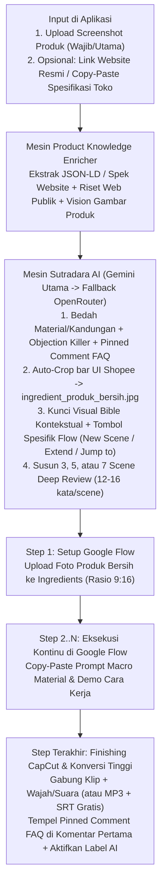

# 🛍️ Shopee & TikTok Affiliate AI Video Director (Deep Product Knowledge Edition)

Aplikasi **Automated Creative Director, Product Specialist & Prompt Engineer** dengan alur kerja **Hybrid (App → Google Flow → CapCut)**.

Dirancang khusus agar video affiliate Anda **menang bersaing dari kompetitor** lewat **Added Value & Deep Product Knowledge** (bedah material/kandungan spesifik, tips pakai pro, *Objection Killer* penjawab keraguan pembeli, dan *Pinned Comment FAQ*), bukan sekadar membaca judul barang secara dangkal.

> 📖 **Panduan Deploy Gratis ke Cloud & Pemakaian 100% dari HP:** Lihat [CARA_PAKAI.md](CARA_PAKAI.md).

---

## 🔄 1. Alur Kerja Hybrid + Deep Product Knowledge



---

## 🏆 2. Senjata Pembeda Kompetitor (Added Value)

1. **Product Knowledge Enricher (`src/knowledge_enricher.py`):** Menarik fakta spesifikasi dari **URL website brand/review** (termasuk metadata `schema.org/Product` JSON-LD), **copy-paste spesifikasi toko**, serta **riset snippet web publik** otomatis sehingga naskah VO kaya fakta teknis nyata.
2. **Mode 7 Scene Deep Review (`40–45 detik`):** Selain mode cepat `15 detik (3 scene)` dan `25–30 detik (5 scene)`, tersedia mode `40–45 detik (7 scene deep)` dengan struktur lengkap: *Hook → Masalah → Bedah Material/Kandungan → Demo Cara Kerja → Objection Killer → Tips Pakai & Value → CTA*.
3. **Kartu Product Knowledge & Pinned Comment FAQ:** Menyediakan jawaban atas keraguan terbesar pembeli di kolom komentar plus teks **Pinned Comment siap 1-klik copy** untuk mendongkrak durasi tonton dan konversi klik keranjang.
4. **Auto-Crop Screenshot Shopee (`src/image_prep.py`) + Gratis `.SRT` & MP3 (`src/srt_export.py`, `src/voiceover.py`) + Riwayat Anti-Spam (`src/history_store.py`).**

---

## 🚀 3. Instalasi & Menjalankan

```bash
cd /Users/bambangtryono/PycharmProjects/video_affliate_generator
cp .env.example .env
# Isi GEMINI_API_KEY (utama) dan OPENROUTER_API_KEY (fallback) di .env

# Jalankan aplikasi
.venv/bin/streamlit run app.py

# Jalankan automated tests
.venv/bin/pytest -v tests/
```
